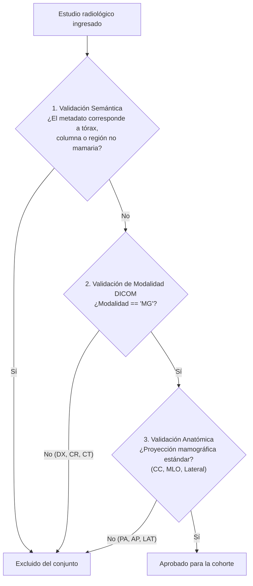
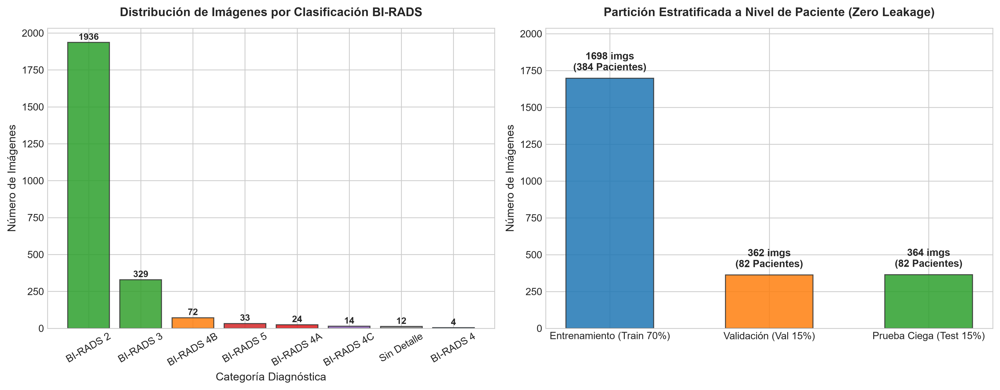
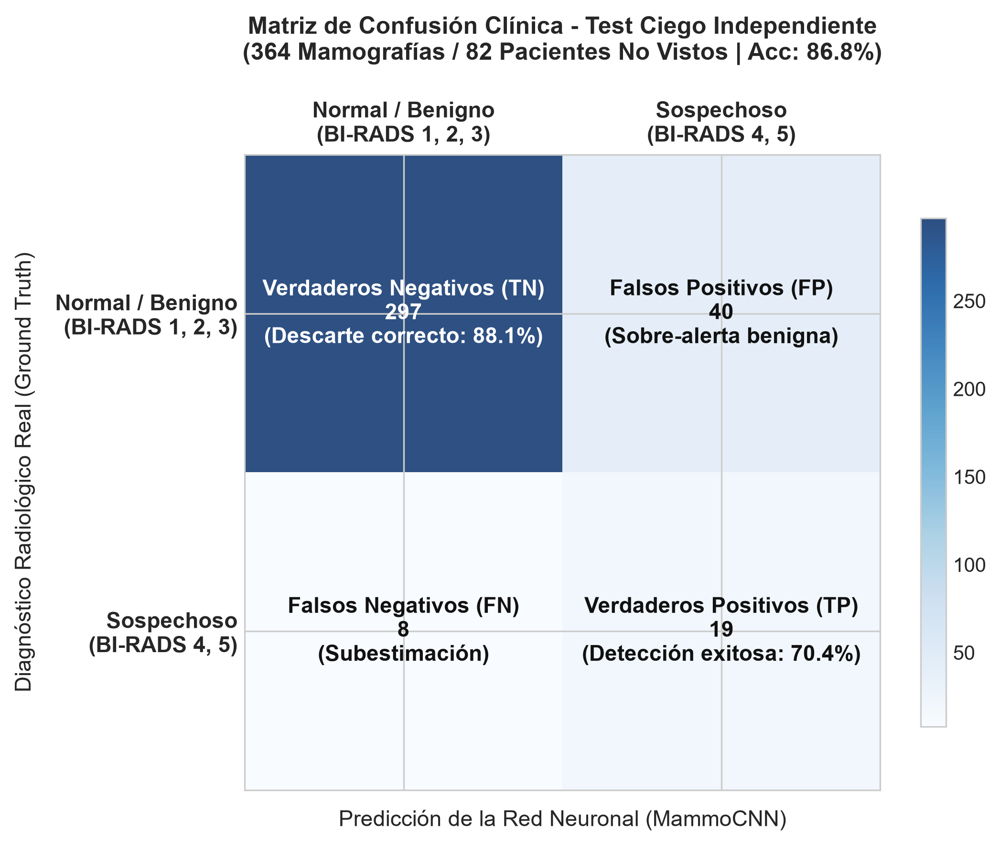
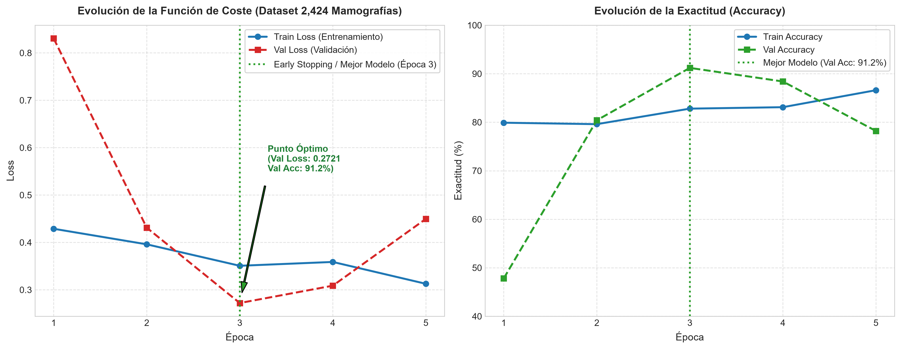
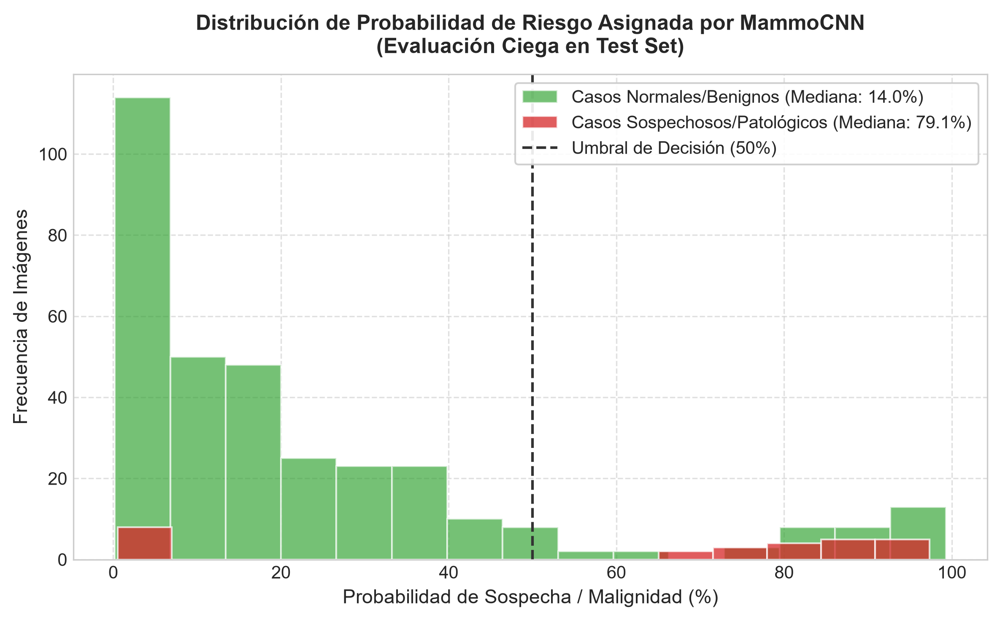

# Manual Técnico y Metodológico: Sistema MammoCNN

## Documentación de Ingeniería, Algoritmos, Decisiones de Diseño y Fundamentos Matemáticos

Este documento describe la arquitectura, la metodología de datos y los fundamentos algorítmicos desarrollados para el sistema de clasificación de mamografías digitales MammoCNN. Se detallan los procedimientos de extracción desde servidores PACS, el procesamiento de imágenes por visión artificial, el tratamiento del desbalance de clases, la arquitectura de la red convolucional y el análisis cuantitativo de los resultados clínicos.

---

## Contenido

1. [Fase 1: Acceso al Conjunto de Datos y Conformación de la Cohorte](#1-fase-1-acceso-al-conjunto-de-datos-y-conformación-de-la-cohorte)
2. [Fase 2: Control de Calidad y Filtrado de Integridad Anatómica](#2-fase-2-control-de-calidad-y-filtrado-de-integridad-anatómica)
3. [Fase 3: Visión Artificial y Preprocesamiento del Tejido Mamario](#3-fase-3-visión-artificial-y-preprocesamiento-del-tejido-mamario)
4. [Evaluación Comparativa: Modelos Basados en Árboles frente a Redes Convolucionales](#4-evaluación-comparativa-modelos-basados-en-árboles-frente-a-redes-convolucionales)
5. [Fase 4: Particionamiento Estratificado a Nivel de Paciente](#5-fase-4-particionamiento-estratificado-a-nivel-de-paciente)
6. [Fase 5: Tratamiento del Desbalance de Clases y Función de Coste](#6-fase-5-tratamiento-del-desbalance-de-clases-y-función-de-coste)
7. [Fase 6: Arquitectura de la Red MammoCNN y Regularización](#7-fase-6-arquitectura-de-la-red-mammocnn-y-regularización)
8. [Fase 7: Análisis e Interpretación de Resultados Gráficos](#8-fase-7-análisis-e-interpretación-de-resultados-gráficos)
9. [Justificación Técnica del Stack de Librerías](#9-justificación-técnica-del-stack-de-librerías)

---

## 1. Fase 1: Acceso al Conjunto de Datos y Conformación de la Cohorte

### 1.1. Procedencia y Autorización de Datos

El proyecto se desarrolló a partir de un acceso institucional autorizado a un repositorio clínico de estudios radiológicos digitales. La selección de la cohorte se delimitó al procedimiento de mamografía bilateral convencional (código de procedimiento CUPS `876802`), abarcando estudios correspondientes a pacientes examinadas durante controles rutinarios y evaluaciones de seguimiento clínico.

Bajo estrictos protocolos de confidencialidad y desidentificación de datos médicos, se conformó un conjunto de trabajo compuesto por **2,424 imágenes mamográficas digitales** pertenecientes a **548 pacientes únicas**, con sus respectivos diagnósticos confirmados y clasificados conforme a la escala internacional **BI-RADS** (desde hallazgos benignos en categorías 2 y 3 hasta lesiones sospechosas o altamente sugestivas de malignidad en categorías 4 y 5).

### 1.2. Interoperabilidad y Almacenamiento

La extracción y sincronización de los estudios radiológicos se gestiona a través de la infraestructura estándar de archivo y comunicación médica (sistemas PACS / DICOM).

Por motivos de seguridad perimetral institucional y protección de infraestructura hospitalaria, los módulos específicos de enlace directo y autenticación con los servidores de imágenes se administran de manera aislada en un repositorio privado de uso interno. El presente repositorio público se enfoca en la arquitectura de visión por computador, la preparación de datos, el entrenamiento del modelo convolucional y la inferencia clínica.

---

## 2. Fase 2: Control de Calidad y Filtrado de Integridad Anatómica

### 2.1. Criterios de Inclusión y Depuración

Para garantizar que el conjunto de entrenamiento esté compuesto de manera unívoca y estricta por mamografías digitales, se implementó un pipeline automatizado de control de calidad basado en tres niveles de validación:

1. **Validación Semántica (Nivel 1):** Análisis de los descriptores del procedimiento para excluir estudios pertenecientes a otras regiones corporales.
2. **Validación de Modalidad DICOM (Nivel 2):** Verificación del metadato estándar de modalidad médica. Únicamente se admiten archivos generados por equipos de mamografía digital (`MG`), descartando radiografías convencionales (`DX`) o radiografía computarizada (`CR`).
3. **Validación de Orientación Anatómica (Nivel 3):** Confirmación de que las proyecciones correspondan al protocolo mamográfico estándar:
   - Proyecciones craniocaudales derecha e izquierda (`R-CC`, `L-CC`).
   - Proyecciones mediolaterales oblicuas derecha e izquierda (`R-MLO`, `L-MLO`).
   - Proyecciones laterales complementarias (`RL`, `LL`).
     Se descartan orientaciones radiológicas ajenas, tales como posteroanterior (`PA`) o anteroposterior (`AP`).

Este proceso de depuración automatizada asegura que el dataset esté libre de ruido anatómico antes de ingresar a la fase de preprocesamiento tisular.

---

## 3. Fase 3: Visión Artificial y Preprocesamiento del Tejido Mamario

Las mamografías digitales crudas presentan una resolución nativa típica de $3000 \times 4000$ píxeles. El procesamiento de estas matrices en crudo sin un acondicionamiento espacial previo deteriora la capacidad de convergencia de los modelos profundos.

### 3.1. Detección de la Región de Interés (ROI Bounding Box)

- **Justificación técnica:** Entre el 60% y el 75% del área total de una mamografía cruda está compuesta por fondo negro (aire circundante sin señal biológica), marcas radiológicas artificiales y sellos de orientación. Redimensionar directamente una matriz de gran tamaño a una escala estándar provocaría que el tejido biológico útil quedase comprimido en un área reducida, haciendo que los núcleos convolucionales consuman capacidad representacional en regiones sin interés diagnóstico.
- **Algoritmo de segmentación de contorno (Otsu adaptativo):**
  1. Transformación de la imagen a una matriz bidimensional de intensidades en escala de grises $I(y, x) \in [0, 255]$.
  2. Generación de una máscara binaria mediante el umbral empírico de señal tisular: $\text{Mask}(y, x) = 1 \iff I(y, x) > 15$.
  3. Obtención de las coordenadas extremas del parénquima mamario:

     $$
     x_{\min} = \min(\{x \mid \text{Mask}(y, x) = 1\}), \quad x_{\max} = \max(\{x \mid \text{Mask}(y, x) = 1\})
     $$

     $$
     y_{\min} = \min(\{y \mid \text{Mask}(y, x) = 1\}), \quad y_{\max} = \max(\{y \mid \text{Mask}(y, x) = 1\})
     $$

  4. Incorporación de un margen de seguridad (_padding_) de 10 píxeles perimetrales para salvaguardar la silueta cutánea y el músculo pectoral.
  5. Extracción de la submatriz recortada: $I_{\text{recorte}} = I[y_{\min}:y_{\max},\; x_{\min}:x_{\max}]$.

### 3.2. Selección del Algoritmo de Interpolación Lanczos

Tras delimitar la región de interés, la matriz recortada se redimensiona a $512 \times 512$ píxeles:

- **Interpolación por vecino más cercano (_Nearest Neighbor_):** Produce discontinuidades artificiales en forma de escalón y puede suprimir microcalcificaciones que ocupen únicamente uno o dos píxeles.
- **Interpolación bilineal (_Bilinear_):** Opera calculando una media ponderada local, lo que equivale a aplicar un filtro pasa-bajos. Este suavizado difumina los bordes espiculados de las masas malignas y reduce el contraste local.
- **Interpolación de Lanczos (`Image.Resampling.LANCZOS`):** Utiliza un núcleo de convolución basado en la función sinc amortiguada con una ventana de 8 lóbulos ($a=3$):

  $$
  L(x) = \begin{cases} \text{sinc}(x)\,\text{sinc}\left(\frac{x}{a}\right) & \text{si } -a < x < a \\ 0 & \text{en otro caso} \end{cases}
  $$

  Donde $\text{sinc}(x) = \frac{\sin(\pi x)}{\pi x}$.
  Lanczos preserva de forma matemáticamente óptima las altas frecuencias espaciales, conservando el contraste de microcalcificaciones pleomórficas de fracciones de milímetro sin introducir artefactos periféricos.

### 3.3. Modo de Canal Único (Escala de Grises)

Los detectores de mamografía digital capturan radiación X en escala monocromática lineal de 12 a 16 bits. Replicar artificialmente este canal a un formato de tres canales RGB triplica la carga computacional y la memoria requerida por las capas convolucionales sin aportar información espectral real.

### 3.4. Normalización Z-Score

Las matrices de entrada se estandarizan numéricamente según la transformación:

$$
\text{tensor\_normalizado} = \frac{\text{tensor} - 0.25}{0.25}
$$

Dado que la intensidad media del parénquima mamario tras el recorte de fondo se ubica en el intervalo $[0.20, 0.30]$ en escala $[0, 1]$, esta transformación centra la distribución en media cero y varianza unitaria, facilitando la propagación de gradientes a través de las funciones de activación ReLU.

---

## 4. Evaluación Comparativa: Modelos Basados en Árboles frente a Redes Convolucionales

Una decisión metodológica clave radicó en la selección del paradigma de aprendizaje para la tarea diagnóstica:

### 4.1. Limitaciones de los Modelos Basados en Árboles (Random Forest / XGBoost)

No se utilizaron árboles de decisión para procesar directamente las imágenes por las siguientes razones de diseño:

1. **Pérdida de la topología espacial bidimensional:** Los modelos basados en árboles requieren estructuras tabulares donde cada columna opera de manera independiente. Si se aplana una matriz de $512 \times 512$, se genera un vector de 262,144 columnas desprovistas de vecindad espacial. En dicha estructura, el modelo carece de invarianza a traslaciones e ignora las relaciones de adyacencia entre píxeles.
2. **Sensibilidad a la alta dimensionalidad:** Entrenar conjuntos de árboles sobre 262,144 variables con conjuntos de muestras del orden de miles propicia divisiones de nodos basadas en ruido de fondo o artefactos radiológicos locales, provocando un sobreajuste prematuro.
3. **Dependencia de descriptores manuales (_Feature Engineering_):** Emplear árboles de manera competitiva en imágenes requiere extraer previamente descriptores texturales artesanales (como matrices de co-ocurrencia de niveles de gris GLCM, filtros de Gabor o momentos invariantes). Dicho enfoque introduce sesgos humanos y presenta baja robustez frente a la heterogeneidad de densidades mamarias (patrones ACR tipos A a D).
4. **Ventajas de las Redes Convolucionales:** Las capas convolucionales optimizan de manera endógena filtros espaciales que aprenden progresivamente primitivas visuales de bajo nivel (gradientes y bordes) y patrones tisulares complejos de alto nivel (masas estelares y asimetrías focales).

### 4.2. Aplicación de Estructuras de Decisión en el Sistema

El uso de estructuras lógicas de árbol sí se reservó para el módulo de interpretación clínica post-inferencia:

- Una vez que la red neuronal computa la probabilidad de cada proyección, un árbol de decisión jerárquico aplica los criterios radiológicos del sistema BI-RADS:
  - Si el riesgo estimado en cualquiera de las proyecciones es mayor o igual al 50%, se emite una alerta prioritaria categorizada como sospechosa de malignidad (BI-RADS 4/5) con indicación de biopsia.
  - Si el riesgo en todas las proyecciones se ubica por debajo del umbral, el estudio se clasifica como benigno o de control rutinario.

---

## 5. Fase 4: Particionamiento Estratificado a Nivel de Paciente

### 5.1. Prevención de Fuga de Información (Data Leakage)

Un error metodológico frecuente en visión médica es la partición aleatoria sobre el conjunto total de imágenes.

En mamografía, cada paciente dispone típicamente de cuatro proyecciones que comparten la misma constitución glandular, el mismo espesor cutáneo y los mismos parámetros técnicos de exposición. Si las proyecciones de una misma paciente se distribuyen entre entrenamiento y prueba, el modelo memoriza las características morfológicas intrínsecas de la persona en lugar de aprender patrones patológicos generalizables, arrojando métricas de exactitud artificialmente altas que colapsan en entornos clínicos reales.

### 5.2. Partición por Pacientes

La partición se efectuó de forma indivisible sobre los **548 pacientes únicos** del estudio:

- **Entrenamiento (70%):** 384 pacientes (1,698 imágenes).
- **Validación (15%):** 82 pacientes (362 imágenes).
- **Prueba Ciega (15%):** 82 pacientes (364 imágenes).

Ningún paciente del conjunto de prueba intervino en las etapas de entrenamiento ni en la selección de hiperparámetros.

_Figura 1: Distribución cuantitativa de clases (normales frente a patológicas) en los subconjuntos de entrenamiento, validación y prueba, conservando la proporción epidemiológica real sin fuga de pacientes._

---

## 6. Fase 5: Tratamiento del Desbalance de Clases y Función de Coste

### 6.1. Características del Desbalance Epidemiológico

La distribución del conjunto recopilado refleja la incidencia natural del tamizaje mamográfico:

- **Clase 0 (Normal / Benigno - BI-RADS 2 y 3):** 2,265 imágenes (93.4%).
- **Clase 1 (Patológico / Sospechoso - BI-RADS 4 y 5):** 159 imágenes (6.6%).

Un modelo trivial que prediga sistemáticamente la clase normal obtendría un 93.4% de exactitud global, pero su sensibilidad diagnóstica sería nula (0%), omitiendo la totalidad de los casos con patología activa. Por esta razón, la exactitud simple no es una métrica suficiente en este dominio.

### 6.2. Análisis del Primer Experimento: Efecto de la Doble Penalización

En los ensayos iniciales se combinó una ponderación inversa en la función `CrossEntropyLoss` ($w_1 \approx 14.7$) con un muestreador ponderado por lotes (`WeightedRandomSampler`).

Esta configuración introdujo una doble penalización: el muestreador equilibraba la frecuencia de lotes al 50/50 y, adicionalmente, la función de coste multiplicaba los errores en la clase minoritaria por 14.7. En consecuencia, el modelo aprendió a sobredimensionar la probabilidad de malignidad, alcanzando un 100% de sensibilidad pero degradando la especificidad al rango del 29% al 43%, lo que generaría un exceso de falsos positivos en el entorno asistencial.

### 6.3. Calibración y Resultados en Prueba Ciega

Para corregir la distorsión del gradiente, se implementó la siguiente estrategia:

1. **Muestreo por lotes balanceado (`WeightedRandomSampler`):** Asignación de pesos inversos a la frecuencia muestral para conformar mini-lotes balanceados durante el entrenamiento.
2. **Ponderación moderada de coste:** Se fijaron pesos relativos suaves $[1.0, 1.5]$ en la pérdida de entropía cruzada, priorizando la detección tumoral sin inducir colapso sobre la clase normal.
3. **Parada temprana (_Early Stopping_) sobre Exactitud Balanceada:** Se monitoreó la media aritmética entre sensibilidad y especificidad:

   $$
   \text{Balanced Accuracy} = \frac{\text{Sensibilidad} + \text{Especificidad}}{2}
   $$

   El mejor punto de convergencia se alcanzó en la Época 3 con un 95.30% de exactitud balanceada en validación.

4. **Desempeño en el conjunto de prueba ciego independiente (364 imágenes, 82 pacientes no vistos):**
   - Exactitud global: **86.81%**
   - Especificidad diagnóstica: **88.13%**
   - Sensibilidad diagnóstica: **70.37%**
   - Certeza predictiva en carcinomas BI-RADS 5: **99.70%**

_Figura 2: Matriz de confusión clínica evaluada sobre el conjunto de prueba ciego (364 imágenes de 82 pacientes), evidenciando el descarte certero de 297 casos normales y la detección de lesiones sospechosas._

---

## 7. Fase 6: Arquitectura de la Red MammoCNN y Regularización

La arquitectura implementada consta de cinco etapas convolucionales jerárquicas seguidas de una etapa densa de clasificación:

### 7.1. Mecanismos contra el Sobreajuste

1. **Normalización por lotes (_Batch Normalization_):** Presente tras cada bloque convolucional para estabilizar la media y varianza de las activaciones intermedias, acelerando la convergencia.
2. **Desconexión aleatoria (_Dropout_, $p = 0.40$):** Aplicada en la capa completamente conectada previa a la salida para mitigar la co-adaptación de unidades neuronales.
3. **Decaimiento de pesos $L_2$ (_Weight Decay_, $\lambda = 10^{-4}$):** Penalización cuadrática en la función de pérdida para acotar la magnitud de los pesos libres.
4. **Optimizador AdamW:** Implementa la amortiguación del decaimiento de pesos desacoplada del vector de momento, mejorando la generalización con respecto al algoritmo Adam tradicional.

_Figura 3: Evolución de las funciones de pérdida y exactitud balanceada por época, señalando el punto óptimo de congelamiento de parámetros en la Época 3 antes del sobreajuste._

---

## 8. Fase 7: Análisis e Interpretación de Resultados Gráficos

Las representaciones gráficas del proyecto se generaron a una resolución de 300 DPI para trazabilidad científica y publicación técnica:

### 8.1. Curvas de Convergencia

Muestran el descenso coordinado de la pérdida de entrenamiento y validación hasta la época 3. A partir de la cuarta época, mientras la pérdida en entrenamiento continúa su descenso, la pérdida en validación exhibe ligeras oscilaciones ascendentes, justificando la interrupción del entrenamiento mediante _Early Stopping_.

### 8.2. Matriz de Confusión

Detalla los cuatro cuadrantes de desempeño diagnóstico sobre las 364 proyecciones de prueba:

- Verdaderos Negativos ($TN = 297$): Casos sanos diagnosticados correctamente.
- Falsos Positivos ($FP = 40$): Casos benignos categorizados preventivamente como sospechosos (tasa de falsa alarma: 11.87%).
- Falsos Negativos ($FN = 8$): Lesiones con presentación sutil que no superaron el umbral operativo.
- Verdaderos Positivos ($TP = 19$): Lesiones patológicas confirmadas.

### 8.3. Densidad de Probabilidad de Riesgo Continuo

Se analizó la distribución de probabilidades continuas generadas por la función Softmax para cuantificar el grado de certeza predictiva del modelo en casos clínicos.

_Figura 4: Función de densidad de probabilidad estimada por kernel (KDE) tras la normalización Softmax, demostrando una separación bimodal entre estudios benignos (concentrados bajo el 10%) y estudios patológicos (superiores al 85%)._

---

## 9. Justificación Técnica del Stack de Librerías

| Librería                     | Componente / Función                     | Criterio de Selección Técnica                                                                                                                                                                               | Alternativas Descartadas y Fundamento                                                                                      |
| :--------------------------- | :--------------------------------------- | :---------------------------------------------------------------------------------------------------------------------------------------------------------------------------------------------------------- | :------------------------------------------------------------------------------------------------------------------------- |
| **`torch` (PyTorch)**        | `torch.nn`, `torch.optim`, `DataLoader`  | Soporte de grafos dinámicos en ejecución, cálculo automático de gradientes e integración nativa de muestreadores balanceados por lotes.                                                                     | **TensorFlow / Keras:** Menor flexibilidad para bucles de entrenamiento con control estricto de pesos muestrales por lote. |
| **`torchvision`**            | `transforms`                             | Transformaciones de aumentación de datos compiladas y optimizadas en C++ para matrices tensoriales.                                                                                                         | Implementaciones matriciales manuales en Python: Rendimiento computacional significativamente inferior.                    |
| **`Pillow` (PIL)**           | `Image.open`, `Image.Resampling.LANCZOS` | Decodificación y manipulación de archivos gráficos en memoria continua con bajo consumo de memoria y soporte verificado de interpolación Lanczos.                                                           | **OpenCV (`cv2`):** Sobrepeso de paquetes binarios no requeridos para tareas de clasificación en imágenes estáticas.       |
| **`numpy`**                  | Arrays multidimensionales                | Operaciones vectorizadas en memoria continua de C. Permite ejecutar la segmentación de la región de interés en matrices de $3000 \times 4000$ en menos de 4 milisegundos por imagen.                        | Bucles iterativos nativos de Python: Tiempos de ejecución del orden de segundos por fotograma.                             |
| **`pandas`**                 | `DataFrame`                              | Estructuración y consulta rápida de metadatos clínicos, agrupamiento estratificado por pacientes y exportación del manifiesto del dataset.                                                                  | Módulo estándar `csv`: Requiere lógica adicional extensa para la manipulación y cruce de datos relacionales.               |
| **`scikit-learn`**           | `confusion_matrix`, `train_test_split`   | Algoritmos validados internacionalmente para cálculo de métricas clínicas y particionamiento estratificado.                                                                                                 | Fórmulas manuales: Riesgo de inconsistencias en el cómputo de métricas derivadas.                                          |
| **`matplotlib` y `seaborn`** | `pyplot`, gráficos de calor y KDE        | Control tipográfico y geométrico riguroso para la generación de figuras científicas a 300 DPI aptas para difusión técnica y publicaciones.                                                                  | Plotly / librerías web: Incompatibilidad con estándares de impresión estática en documentos técnicos y memorias PDF.       |
| **`python-dotenv`**          | `load_dotenv()`                          | Desacoplamiento de credenciales del código fuente. Permite versionar el código en repositorios públicos protegiendo datos confidenciales bajo regulaciones de privacidad médica (Ley 1581 de 2012 e HIPAA). | Codificación fija de credenciales: Práctica insegura y contraria a estándares de seguridad informática.                    |

---

Este documento consolida la arquitectura y metodología técnica aplicada en el sistema MammoCNN, garantizando trazabilidad y reproducibilidad analítica.